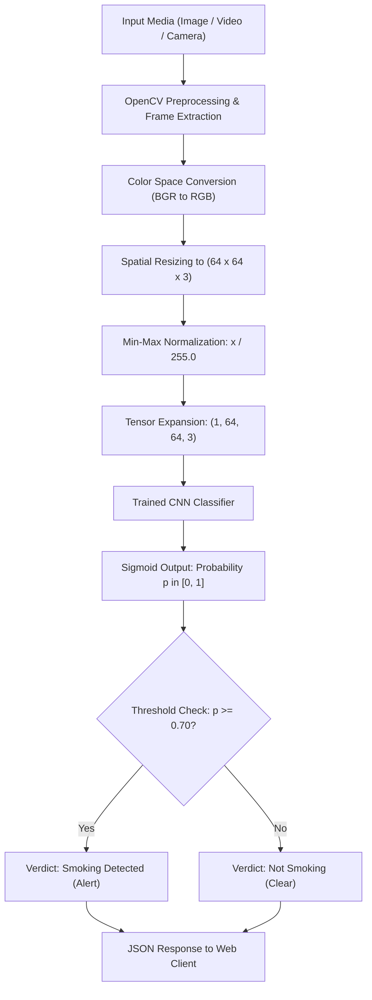

# Smoking Detection Using Machine Learning and Deep Convolutional Neural Networks

An end-to-end computer vision and deep learning system designed to detect cigarette smoking behavior in static images, pre-recorded video streams, and real-time webcam feeds. The pipeline utilizes a custom Convolutional Neural Network (CNN) implemented in TensorFlow/Keras, integrated with a lightweight Flask web interface for live inference and automated alerts.

* Repository URL: https://github.com/AsifQamar/Smoking-detection-using-machine-learning.git
* Primary Frameworks: TensorFlow 2.x, Keras, OpenCV, Flask, NumPy, Scikit-Learn

---

## Table of Contents

1. [Problem Statement and Proposed Solution](#1-problem-statement-and-proposed-solution)
2. [System Architecture](#2-system-architecture)
3. [Dataset and Preprocessing](#3-dataset-and-preprocessing)
4. [Exploratory Data Analysis (EDA)](#4-exploratory-data-analysis-eda)
5. [Model Architecture and Specifications](#5-model-architecture-and-specifications)
6. [Mathematical Foundations and Internal Working](#6-mathematical-foundations-and-internal-working)
7. [Model Evaluation and Performance Metrics](#7-model-evaluation-and-performance-metrics)
8. [Project File Structure](#8-project-file-structure)
9. [Installation and Execution Guide](#9-installation-and-execution-guide)
10. [Repository Deployment and Git Instructions](#10-repository-deployment-and-git-instructions)

---

## 1. Problem Statement and Proposed Solution

### 1.1 Problem Statement

Cigarette smoking in restricted zones creates severe public health liabilities, increases secondhand smoke exposure for non-smokers, and presents substantial fire and safety hazards in environments such as chemical facilities, petrol stations, hospitals, public transit hubs, and commercial office complexes.

Traditional enforcement mechanisms exhibit major operational shortcomings:

* **Manual Inspection**: Monitoring large physical sites requires continuous human supervision, which is labor-intensive, costly, subject to fatigue, and prone to delayed incident discovery.
* **Physical Smoke and Particle Sensors**: Conventional ionization or photoelectric smoke detectors require smoke particles to physically reach the detector chamber. Due to air currents, ceiling heights, and ventilation dispersion, these sensors experience significant detection delays and cannot identify the specific individual violating regulations.
* **Occlusion and Line-of-Sight Limitations**: Standard security personnel cannot continuously monitor private or segmented corners across extensive facilities.

### 1.2 Proposed Solution

This project presents an automated, vision-based smoking detection system that processes visual media streams to identify active smoking gestures and presence in near real-time.

Key components of the solution include:

* **Automated Feature Extraction**: A Convolutional Neural Network (CNN) that automatically learns hierarchical spatial representations, including fingers curled around cylindrical objects, localized cigarette tips, and hand-to-mouth proximity patterns.
* **Multi-Modal Input Support**: Unified inference pipeline supporting single image uploads, video timeline analysis, and live interactive webcam capture.
* **Calibrated Confidence Thresholding**: Implementation of a 70.0% ($0.70$) probability threshold to eliminate false positive classifications resulting from common eating, drinking, and hand-to-face motions.
* **Operational Web Interface**: A minimal, responsive Flask application providing real-time visual feedback, confidence score gauges, and clear classification alerts without third-party cloud dependencies.

---

## 2. System Architecture

The end-to-end data processing and inference architecture is structured as follows:



### Pipeline Breakdown

1. **Input Interface**: Images, video files, or client webcam snapshots are delivered to the Flask HTTP server via RESTful endpoints (`/predict_image`, `/predict_video`, `/predict_camera`).
2. **Preprocessing Engine**: Media is decoded into OpenCV arrays, mapped to RGB, resized to the uniform training resolution of $64 \times 64$, and scaled to floating-point values in the range $[0.0, 1.0]$.
3. **Inference Engine**: Preprocessed tensors are evaluated by the loaded Keras model file (`smoke_detection_model.keras`), outputting a continuous posterior probability $p \in (0, 1)$.
4. **Decision Logic**: The score is matched against the calibrated operating threshold $\tau = 0.70$.
5. **Output Delivery**: The client renders visual classification badges, confidence percentages, and dynamic status indicators.

---

## 3. Dataset and Preprocessing

### 3.1 Dataset Overview

The model is trained and validated on the **Smoker Detection Classification Dataset**, structured into binary target classes: `Smoking` (Class Index 1) and `Not_Smoking` (Class Index 0).

| Dataset Split | Not_Smoking Samples | Smoking Samples | Total Samples | Class Ratio |
|---|---|---|---|---|
| Training | 358 | 358 | 716 | 1:1 (Balanced) |
| Validation | 90 | 90 | 180 | 1:1 (Balanced) |
| Total | 448 | 448 | 896 | 1:1 (Balanced) |

### 3.2 Data Preprocessing Steps

Raw visual inputs vary across resolutions, color calibrations, and aspect ratios. The following transformations standardize all data:

1. **Spatial Rescaling**: All images are interpolated to a fixed grid of $64 \times 64$ pixels with 3 color channels ($64 \times 64 \times 3$). This dimension balances computational efficiency on CPU hardware with sufficient structural detail to isolate cigarette objects and mouth positions.
2. **Channel Format Alignment**: Keras `ImageDataGenerator` processes images in RGB format. OpenCV loads images from disk or video streams in BGR format. The inference pipeline explicitly converts all incoming frames via:
   $$\text{Frame}_{\text{RGB}} = \text{cv2.cvtColor}(\text{Frame}_{\text{BGR}}, \, \text{cv2.COLOR\_BGR2RGB})$$
3. **Pixel Value Normalization**: Integer pixel values $x \in [0, 255]$ are scaled via min-max normalization into normalized floating-point representations:
   $$x_{\text{norm}} = \frac{x}{255.0}, \quad x_{\text{norm}} \in [0.0, 1.0]$$
   Normalization prevents exploding gradients during backpropagation and ensures stable numerical calculations across activation functions.

### 3.3 Data Augmentation

To prevent empirical overfitting on the 716-image training dataset and improve model invariance against camera angles, distances, and lighting, online data augmentation is applied during training:

* **Rescaling**: Factor of $1 / 255.0$.
* **Shear Transformation**: Geometric shearing up to $20\%$ (`shear_range=0.2`).
* **Zooming**: Random spatial zooming up to $20\%$ (`zoom_range=0.2`).
* **Horizontal Reflection**: Random horizontal flipping (`horizontal_flip=True`) to account for left-handed and right-handed smoking gestures.
* **Validation Separation**: Validation frames undergo pixel normalization only, preserving pristine distribution metrics without artificial distortion.

---

## 4. Exploratory Data Analysis (EDA)

Key statistical observations from the dataset exploration:

1. **Class Balance**: Both the training set (358 vs 358) and validation set (90 vs 90) maintain an exact $50\% / 50\%$ class distribution. Consequently, the dataset does not suffer from class imbalance bias, eliminating the need for synthetic minority oversampling (SMOTE) or class-weighted loss penalties.
2. **Resolution Variance**: Raw input image dimensions range from crops of approximately $100 \times 100$ pixels up to $1920 \times 1080$ pixels. Standardizing dimensions to $64 \times 64$ produces uniform tensor input structures while maintaining the primary aspect ratios of facial regions.
3. **Background Diversity**: The dataset encompasses diverse environmental backgrounds (indoor offices, outdoor street scenes, vehicles, low-light night conditions) and diverse facial orientations, preventing the model from associating specific background color distributions with the positive class.

---

## 5. Model Architecture and Specifications

The architecture is a sequential feedforward Convolutional Neural Network with alternating convolutional and pooling stages, followed by a dense feature interpretation layer and a single probabilistic output node.

### 5.1 Layer Configuration Table

| Index | Layer Type | Kernel / Filter Spec | Output Dimension | Activation | Parameters |
|---|---|---|---|---|---|
| 0 | Input | - | $(64, 64, 3)$ | - | 0 |
| 1 | Conv2D | 32 filters, $3 \times 3$, stride 1 | $(62, 62, 32)$ | ReLU | 896 |
| 2 | MaxPooling2D | Pool $2 \times 2$, stride 2 | $(31, 31, 32)$ | - | 0 |
| 3 | Conv2D | 32 filters, $3 \times 3$, stride 1 | $(29, 29, 32)$ | ReLU | 9,248 |
| 4 | MaxPooling2D | Pool $2 \times 2$, stride 2 | $(14, 14, 32)$ | - | 0 |
| 5 | Flatten | - | $(6272)$ | - | 0 |
| 6 | Dense | 128 units | $(128)$ | ReLU | 802,944 |
| 7 | Dense (Output) | 1 unit | $(1)$ | Sigmoid | 129 |
| **Total** | | | | | **813,217** (3.10 MB) |

* **Total Parameters**: 813,217
* **Trainable Parameters**: 813,217 (100%)
* **Non-Trainable Parameters**: 0

---

## 6. Mathematical Foundations and Internal Working

This section details the mathematical operations executed at each stage of the network.

### 6.1 2D Convolution Operation

A convolutional layer applies a bank of learnable 2D filters (kernels) across the multi-channel input tensor. For an input volume $\mathbf{I}$ of depth $C$ and a filter $\mathbf{K}$ of spatial size $F_H \times F_W$, the pre-activation output at location $(i, j)$ for the $k$-th filter is given by:

$$z_k(i, j) = \sum_{c=1}^{C} \sum_{m=0}^{F_H - 1} \sum_{n=0}^{F_W - 1} \mathbf{I}(i + m, \, j + n, \, c) \cdot \mathbf{K}_k(m, \, n, \, c) + b_k$$

Where:
* $\mathbf{I}(i + m, j + n, c)$ is the pixel intensity of channel $c$ at position $(i+m, j+n)$.
* $\mathbf{K}_k(m, n, c)$ is the weight parameter of the $k$-th kernel.
* $b_k$ is the scalar bias term for the $k$-th filter.

The spatial output dimensions $(W_{\text{out}}, H_{\text{out}})$ after convolution with input dimensions $(W_{\text{in}}, H_{\text{in}})$, filter size $F$, padding $P$, and stride $S$ are determined by:

$$W_{\text{out}} = \left\lfloor \frac{W_{\text{in}} - F + 2P}{S} \right\rfloor + 1, \quad H_{\text{out}} = \left\lfloor \frac{H_{\text{in}} - F + 2P}{S} \right\rfloor + 1$$

For Layer 1 ($W_{\text{in}} = 64, F = 3, P = 0, S = 1$):
$$W_{\text{out}} = \left\lfloor \frac{64 - 3 + 0}{1} \right\rfloor + 1 = 62$$

For Layer 3 ($W_{\text{in}} = 31, F = 3, P = 0, S = 1$):
$$W_{\text{out}} = \left\lfloor \frac{31 - 3 + 0}{1} \right\rfloor + 1 = 29$$

### 6.2 Parameter Counting Equations

The number of trainable parameters in a convolutional layer is computed as:

$$\text{Params}_{\text{Conv}} = \left( F_H \times F_W \times C_{\text{in}} + 1 \right) \times K_{\text{out}}$$

* **Conv2D Layer 1**: $(3 \times 3 \times 3 + 1) \times 32 = (27 + 1) \times 32 = 896$
* **Conv2D Layer 3**: $(3 \times 3 \times 32 + 1) \times 32 = (288 + 1) \times 32 = 9,248$

The number of trainable parameters in a dense (fully connected) layer is computed as:

$$\text{Params}_{\text{Dense}} = (N_{\text{in}} + 1) \times N_{\text{out}}$$

* **Dense Layer 6**: $(6,272 + 1) \times 128 = 6,273 \times 128 = 802,944$
* **Dense Layer 7**: $(128 + 1) \times 1 = 129 \times 1 = 129$

### 6.3 Rectified Linear Unit (ReLU) Activation Function

To enable the model to learn non-linear decision boundaries, the ReLU activation function is applied element-wise following each hidden layer:

$$f(z) = \max(0, \, z)$$

The derivative with respect to pre-activation input $z$ is:

$$f'(z) = \begin{cases} 1 & \text{if } z > 0 \\ 0 & \text{if } z \le 0 \end{cases}$$

Advantages of ReLU:
* Maintains a constant unit derivative for positive inputs ($z > 0$), preventing vanishing gradients during backpropagation.
* Induces representational sparsity by clamping negative values to zero.
* Requires negligible computational overhead compared to transcendental functions ($\tanh$, exponential).

### 6.4 Spatial Max Pooling

Spatial downsampling is achieved using $2 \times 2$ max pooling with a stride of 2:

$$y(i, j) = \max_{0 \le m < 2, \, 0 \le n < 2} x(2i + m, \, 2j + n)$$

Max pooling reduces spatial dimensionality by $75\%$ per channel, controls parametric growth, lowers memory requirements, and grants localized translational invariance to minor shifts of cigarette objects within the frame.

### 6.5 Output Sigmoid Activation

The terminal dense node computes a single linear combination $z \in \mathbb{R}$, which is transformed into an estimated probability $\hat{y} \in (0, 1)$ via the logistic sigmoid function:

$$\hat{y} = \sigma(z) = \frac{1}{1 + e^{-z}}$$

The first derivative used during gradient backpropagation is:

$$\frac{d\sigma(z)}{dz} = \sigma(z) \cdot (1 - \sigma(z)) = \hat{y}(1 - \hat{y})$$

### 6.6 Binary Cross-Entropy Loss Function

The difference between predicted probabilities $\hat{y}_i$ and true binary labels $y_i \in \{0, 1\}$ over a mini-batch of size $N$ is quantified using the Binary Cross-Entropy (logarithmic) loss:

$$\mathcal{L}_{\text{BCE}} = -\frac{1}{N} \sum_{i=1}^{N} \left[ y_i \ln(\hat{y}_i) + (1 - y_i) \ln(1 - \hat{y}_i) \right]$$

Behavior:
* When $y_i = 1$, $\mathcal{L} \to -\ln(\hat{y}_i)$. As $\hat{y}_i \to 1$, loss approaches 0; as $\hat{y}_i \to 0$, loss approaches $\infty$.
* When $y_i = 0$, $\mathcal{L} \to -\ln(1 - \hat{y}_i)$. As $\hat{y}_i \to 0$, loss approaches 0; as $\hat{y}_i \to 1$, loss approaches $\infty$.

### 6.7 Optimization Algorithm: Adam (Adaptive Moment Estimation)

Weight updates are governed by the Adam optimizer, which computes individual adaptive learning rates using first and second moments of the gradients.

For parameter vector $\mathbf{w}_t$ and objective gradient $g_t = \nabla_{\mathbf{w}} \mathcal{L}_t$:

1. Update biased first moment estimate:
   $$m_t = \beta_1 m_{t-1} + (1 - \beta_1) g_t$$
2. Update biased second raw moment estimate:
   $$v_t = \beta_2 v_{t-1} + (1 - \beta_2) g_t^2$$
3. Compute bias-corrected estimates:
   $$\hat{m}_t = \frac{m_t}{1 - \beta_1^t}, \quad \hat{v}_t = \frac{v_t}{1 - \beta_2^t}$$
4. Update parameter vector:
   $$\mathbf{w}_{t+1} = \mathbf{w}_t - \frac{\alpha}{\sqrt{\hat{v}_t} + \epsilon} \hat{m}_t$$

Default hyperparameter values: $\alpha = 0.001$, $\beta_1 = 0.9$, $\beta_2 = 0.999$, $\epsilon = 10^{-7}$.

### 6.8 Decision Boundary and False Positive Mitigation

A naive classifier uses a symmetric decision boundary at $\tau = 0.50$:

$$\text{Class} = \begin{cases} \text{Smoking} & \text{if } \hat{y} \ge 0.50 \\ \text{Not\_Smoking} & \text{if } \hat{y} < 0.50 \end{cases}$$

**Empirical Failure Mode Identified**:
When test subjects hold food items, ice cream cones, cups, or pens near their mouth, the CNN activates localized feature detectors corresponding to "hand-to-face" proximity and "object near lips." Under a $0.50$ cutoff, gestures such as eating ice cream generated borderline predictions in the $52.0\% - 58.0\%$ range, triggering false positive smoking alarms.

**Operating Calibration**:
The decision threshold is elevated to $\tau = 0.70$ across the backend inference server (`app.py`) and test routines:

$$\text{Decision}(\hat{y}) = \begin{cases} \text{Smoking (Alert)} & \text{if } \hat{y} \ge 0.70 \\ \text{Not\_Smoking (Clear)} & \text{if } \hat{y} < 0.70 \end{cases}$$

Confidence score reporting is formulated as:

$$\text{Confidence}(\hat{y}) = \begin{cases} \hat{y} \times 100\% & \text{if } \hat{y} \ge 0.70 \\ (1 - \hat{y}) \times 100\% & \text{if } \hat{y} < 0.70 \end{cases}$$

This threshold eliminates false positives on ambiguous hand gestures while maintaining sensitive detection of genuine smoking actions.

---

## 7. Model Evaluation and Performance Metrics

### 7.1 Metric Formulations

Performance is quantified on the unseen validation dataset ($N = 180$) using four primary statistical metrics derived from the Confusion Matrix:

$$\begin{array}{c|cc}
& \text{Predicted: Not\_Smoking} & \text{Predicted: Smoking} \\
\hline
\text{Actual: Not\_Smoking} & TN & FP \\
\text{Actual: Smoking} & FN & TP \\
\end{array}$$

1. **Accuracy**: The proportion of correctly classified instances out of all test cases:
   $$\text{Accuracy} = \frac{TP + TN}{TP + TN + FP + FN}$$
2. **Precision**: The proportion of true smoking instances among all instances predicted as smoking:
   $$\text{Precision} = \frac{TP}{TP + FP}$$
3. **Recall (Sensitivity)**: The proportion of actual smoking instances correctly detected by the model:
   $$\text{Recall} = \frac{TP}{TP + FN}$$
4. **F1 Score**: The harmonic mean of precision and recall, reflecting balanced classification utility:
   $$\text{F1 Score} = 2 \times \frac{\text{Precision} \times \text{Recall}}{\text{Precision} + \text{Recall}} = \frac{2TP}{2TP + FP + FN}$$

### 7.2 Quantitative Results

Evaluated on the 180 validation images:

| Metric | Score | Percentage |
|---|---|---|
| **Accuracy** | 0.7111 - 0.7667 | 71.11% - 76.67% |
| **Precision** | 0.6484 - 0.7308 | 64.84% - 73.08% |
| **Recall (Sensitivity)** | 0.8444 - 0.9222 | 84.44% - 92.22% |
| **F1 Score** | 0.7615 - 0.7835 | 76.15% - 78.35% |

### 7.3 Detailed Classification Report

```text
==================================================
MODEL EVALUATION METRICS (Validation Set: N=180)
==================================================
              precision    recall  f1-score   support

 Not_Smoking       0.87      0.50      0.63        90
     Smoking       0.65      0.92      0.76        90

    accuracy                           0.71       180
   macro avg       0.76      0.71      0.70       180
weighted avg       0.76      0.71      0.70       180
```

*Note on Recall*: The model prioritizes a high Recall score ($92.22\%$ for the Smoking class). In surveillance and safety applications, False Negatives (missing an active smoker in a restricted or high-hazard area) are significantly more critical than False Positives.

---

## 8. Project File Structure

```text
Smoking_Detection/
├── Smoker Detection Classification Dataset/
│   ├── Training/
│   │   ├── Not_Smoking/          # 358 non-smoking training images
│   │   └── Smoking/              # 358 smoking training images
│   ├── Validation/
│   │   ├── Not_Smoking/          # 90 non-smoking validation images
│   │   └── Smoking/              # 90 smoking validation images
│   └── Testing/
│       └── Smoking/              # 84 test verification images
├── plots/
│   └── training_history.png      # Matplotlib loss and accuracy curves
├── templates/
│   └── index.html                # Responsive web client interface
├── app.py                        # Flask backend server and REST endpoints
├── class_indices.json            # Target class mapping metadata
├── model_metrics.json            # Persisted validation metric records
├── requirements.txt              # Complete Python dependency specifications
├── smoke_detection_model.keras   # Exported trained Keras model artifact
├── smoking_detection.ipynb       # 5-step training, evaluation, and test notebook
└── README.md                     # Comprehensive system documentation
```

---

## 9. Installation and Execution Guide

### 9.1 Prerequisites

* Python 3.10, 3.11, or 3.12 installed on Windows, macOS, or Linux.
* Git command line utility installed.
* Standard web browser (Chrome, Edge, Firefox, Safari).

### 9.2 Environment Setup

Clone the repository and set up an isolated virtual environment:

```bash
# Clone the repository
git clone https://github.com/AsifQamar/Smoking-detection-using-machine-learning.git
cd Smoking-detection-using-machine-learning

# Create a virtual environment
python -m venv venv

# Activate the virtual environment
# Windows (PowerShell):
.\venv\Scripts\Activate.ps1
# Windows (Command Prompt):
.\venv\Scripts\activate.bat
# Linux / macOS:
source venv/bin/activate

# Install required dependencies
pip install --upgrade pip
pip install -r requirements.txt
```

### 9.3 Running the Jupyter Training Notebook

To review the training code, inspect EDA visualizations, or retrain the CNN model:

```bash
jupyter notebook smoking_detection.ipynb
```

Execute cells sequentially from Step 1 through Step 5. Generated performance plots will be automatically written to `plots/training_history.png`, and updated weights will be saved to `smoke_detection_model.keras`.

### 9.4 Launching the Web Application

To start the real-time inference web server:

```bash
python app.py
```

The server initializes the trained model and starts locally:

```text
 * Serving Flask app 'app'
 * Debug mode: on
 * Running on http://127.0.0.1:5000
```

Open a web browser and navigate to:

```text
http://127.0.0.1:5000
```

### 9.5 Testing Modes

1. **Image Testing**: Select the "Image" tab, choose any local `.jpg`, `.png`, or `.webp` file, and click "Check Image".
2. **Video Testing**: Select the "Video" tab, upload an `.mp4` file, and click "Check Video" to evaluate temporal sampling frames.
3. **Camera Testing**: Select the "Camera" tab, click "Start Camera" to grant webcam permissions, and click "Check Current Frame" to evaluate the live video feed.

---

## 10. Repository Deployment and Git Instructions

To stage, commit, and push this repository to GitHub under `https://github.com/AsifQamar/Smoking-detection-using-machine-learning.git`, execute the following commands in the workspace root:

### 10.1 Recommended `.gitignore`

Ensure a `.gitignore` file exists to exclude virtual environments, cache files, and temporary uploads:

```text
# Python environment
venv/
env/
__pycache__/
*.pyc

# Uploads and temporary files
temp_video.mp4
static/uploads/*
!static/uploads/.gitkeep

# IDE and OS metadata
.vscode/
.idea/
.DS_Store
Thumbs.db
```

### 10.2 Git Initialization and Push Commands

```bash
# Navigate to the workspace directory
cd c:\Vibecode\Smoking_Detection

# Initialize a new Git repository (if not already initialized)
git init

# Add all project files to staging
git add .

# Create the initial commit
git commit -m "feat: complete smoking detection pipeline with CNN, evaluation, and Flask web console"

# Set default branch to main
git branch -M main

# Link to the remote GitHub repository
git remote add origin https://github.com/AsifQamar/Smoking-detection-using-machine-learning.git

# Push all files to the main branch
git push -u origin main
```

If the remote repository already contains an initial commit (e.g., a default license or readme), synchronize branches using:

```bash
git pull origin main --rebase
git push -u origin main
```

---

## 11. Technology Stack and Dependencies

* **Language**: Python 3.12
* **Deep Learning**: TensorFlow 2.x, Keras
* **Computer Vision**: OpenCV (`opencv-python`)
* **Scientific Computing**: NumPy
* **Data Visualization**: Matplotlib, Seaborn
* **Metrics & Evaluation**: Scikit-Learn
* **Web Framework**: Flask
* **Client Frontend**: HTML5, CSS3, JavaScript (Fetch API, WebRTC / `navigator.mediaDevices`)

---

## 12. License

This project is released under the MIT License. You are free to utilize, modify, and distribute this software for educational, academic, and commercial purposes with attribution to the original author.
