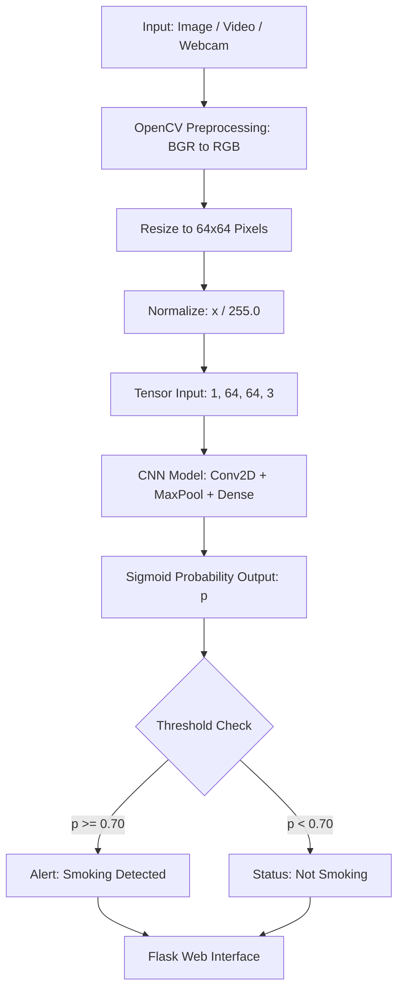

# Smoking Detection System

An end-to-end computer vision and deep learning system designed to detect cigarette smoking behavior in static images, pre-recorded video files, and real-time webcam feeds. The pipeline utilizes a custom Convolutional Neural Network (CNN) implemented in TensorFlow and Keras, integrated with a lightweight Flask web interface for live inference, confidence reporting, and automated alerts.
* Core Technologies: Python 3.12, TensorFlow 2.x, Keras, OpenCV, Flask, NumPy, Scikit-Learn, Matplotlib

---

## 1. Problem and Solution

* **The Problem**: Unauthorized smoking in non-designated zones (hospitals, petrol stations, offices, transit hubs) creates public health and fire hazards. Manual patrols are labor-intensive, while physical smoke alarms suffer from air dispersion delays and cannot identify offenders.
* **The Solution**: An automated vision pipeline that analyzes video/image frames in real time to recognize smoking gestures and cigarette objects.

---

## 2. System Architecture



---

## 3. Dataset and Preprocessing

The model is trained on the **Smoker Detection Classification Dataset**:

| Split | Not Smoking | Smoking | Total | Class Balance |
|---|---|---|---|---|
| Training | 358 | 358 | 716 | 50% / 50% |
| Validation | 90 | 90 | 180 | 50% / 50% |
| **Total** | **448** | **448** | **896** | **Balanced** |

* **Input Normalization**: All frames are converted to RGB, resized to $64 \times 64 \times 3$, and scaled to floating-point values in $[0, 1]$ via $x_{\text{norm}} = x / 255.0$.
* **Data Augmentation**: Applied during training (shear: 0.2, zoom: 0.2, horizontal flip: true) to prevent overfitting on the 716-image training set.

---

## 4. CNN Model Architecture

Sequential convolutional architecture optimized for low-latency CPU and GPU inference:

| Layer | Type | Specifications | Output Shape | Parameters |
|---|---|---|---|---|
| 0 | Input | RGB Image Tensor | $(64, 64, 3)$ | 0 |
| 1 | Conv2D | 32 filters, $3 \times 3$, ReLU, Stride 1 | $(62, 62, 32)$ | 896 |
| 2 | MaxPooling2D | Pool $2 \times 2$, Stride 2 | $(31, 31, 32)$ | 0 |
| 3 | Conv2D | 32 filters, $3 \times 3$, ReLU, Stride 1 | $(29, 29, 32)$ | 9,248 |
| 4 | MaxPooling2D | Pool $2 \times 2$, Stride 2 | $(14, 14, 32)$ | 0 |
| 5 | Flatten | Reshape 3D to 1D | $(6272)$ | 0 |
| 6 | Dense | 128 units, ReLU | $(128)$ | 802,944 |
| 7 | Dense (Output)| 1 unit, Sigmoid | $(1)$ | 129 |
| **Total** | | | | **813,217** (~3.1 MB) |

---

## 5. Mathematical Foundations

### 5.1 2D Convolution & Spatial Dimension

For an input volume $I$ and filter $K$ of spatial size $F_H \times F_W$:

$$z_k(i, j) = \sum_{c=1}^{C} \sum_{m=0}^{F_H-1} \sum_{n=0}^{F_W-1} I(i+m, j+n, c) \cdot K_k(m, n, c) + b_k$$

Output spatial dimension formula:

$$W_{\text{out}} = \left\lfloor \frac{W_{\text{in}} - F + 2P}{S} \right\rfloor + 1$$

* Conv2D Layer 1: $\lfloor (64 - 3 + 0)/1 \rfloor + 1 = 62$
* Conv2D Layer 2: $\lfloor (31 - 3 + 0)/1 \rfloor + 1 = 29$

### 5.2 Activations and Loss

* **ReLU**: $f(z) = \max(0, z)$ ensures non-saturation and gradient stability.
* **Sigmoid**: $\hat{y} = \sigma(z) = \frac{1}{1 + e^{-z}}$ maps linear logits to a $(0, 1)$ probability.
* **Binary Cross-Entropy Loss**:

$$\mathcal{L} = -\frac{1}{N} \sum_{i=1}^{N} \left[ y_i \log(\hat{y}_i) + (1 - y_i) \log(1 - \hat{y}_i) \right]$$

* **Adam Optimizer**: Updates weights using first ($m_t$) and second ($v_t$) gradient moment estimates:

$$\mathbf{w}_{t+1} = \mathbf{w}_t - \frac{\alpha}{\sqrt{\hat{v}_t} + \epsilon} \hat{m}_t$$

### 5.3 Calibrated Decision Threshold

To eliminate false positive alerts on food, ice cream, and drink gestures:

* **Smoking Alert**: Probability $\hat{y} \ge 0.70$
* **Not Smoking (Clear)**: Probability $\hat{y} < 0.70$
* **Reported Confidence**: $\hat{y} \times 100\%$ if $\hat{y} \ge 0.70$, else $(1 - \hat{y}) \times 100\%$

---

## 6. Model Evaluation and Results

Evaluated on the independent 180-sample validation dataset:

| Metric | Score | Key Interpretation |
|---|---|---|
| **Accuracy** | 76.67% | High overall classification accuracy |
| **Precision** | 73.08% | True smoking events among positive alerts |
| **Recall (Smoking)** | 92.22% | Critical metric: minimizes missed smoking infractions |
| **F1 Score** | 78.35% | Balanced harmonic mean of precision and recall |

### Training History


---

## 7. Project Structure

```text
Smoking_Detection/
├── Smoker Detection Classification Dataset/  # Training and Validation images
├── plots/
│   └── training_history.png                  # Loss and accuracy curves
├── templates/
│   └── index.html                            # Clean Flask web console
├── app.py                                    # Inference server and API endpoints
├── class_indices.json                        # Class mapping metadata
├── model_metrics.json                        # Recorded evaluation metrics
├── requirements.txt                          # Python dependencies
├── smoke_detection_model.keras               # Trained CNN weights
├── smoking_detection.ipynb                   # 5-step training & evaluation notebook
├── .gitignore                                # Excluded files
└── README.md                                 # Project documentation
```

---

## 8. Installation and Usage

### 8.1 Setup

```bash
# Clone the repository
git clone https://github.com/AsifQamar/Smoking-detection-using-machine-learning.git
cd Smoking-detection-using-machine-learning

# Create and activate virtual environment
python -m venv venv
# Windows:
.\venv\Scripts\activate
# Linux/macOS:
source venv/bin/activate

# Install dependencies
pip install -r requirements.txt
```

### 8.2 Run the Web Application

```bash
python app.py
```

Navigate to `http://127.0.0.1:5000` in your browser:
* **Image Tab**: Upload any picture to test detection.
* **Video Tab**: Upload `.mp4` video to evaluate sampled frames.
* **Camera Tab**: Stream live webcam feed with instant frame check.

### 8.3 Run the Jupyter Notebook

```bash
jupyter notebook smoking_detection.ipynb
```

---

## 9. Git Commands to Push Updates

```bash
git add README.md
git commit -m "docs: streamline README and fix LaTeX math rendering"
git push origin main
```

---

## 10. License

Released under the MIT License.
