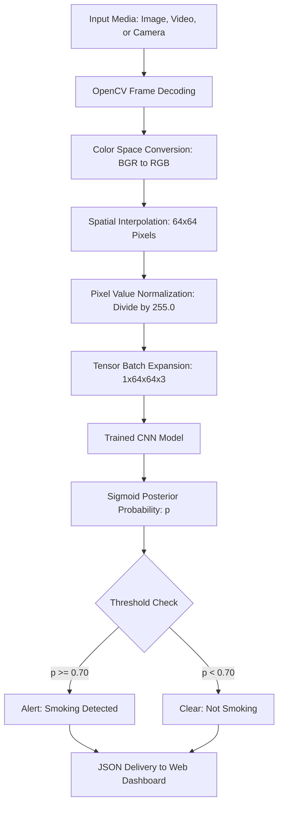
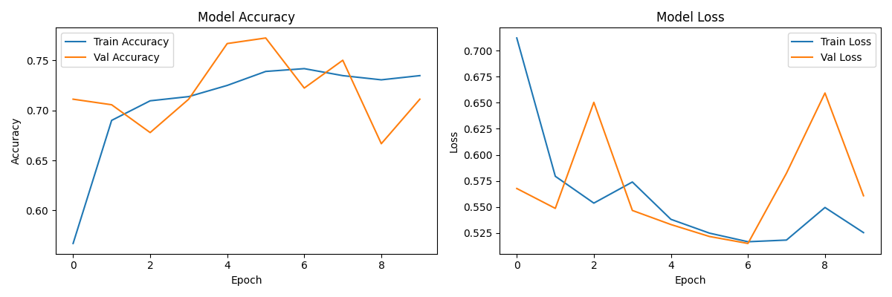

# Smoking Detection Using Machine Learning and Deep Convolutional Neural Networks

An end-to-end computer vision and deep learning system designed to detect cigarette smoking behavior in static images, pre-recorded video files, and real-time webcam feeds. The pipeline utilizes a custom Convolutional Neural Network (CNN) implemented in TensorFlow and Keras, integrated with a lightweight Flask web interface for live inference, confidence reporting, and automated alerts.

* Repository: https://github.com/AsifQamar/Smoking-detection-using-machine-learning.git
* Core Technologies: Python 3.12, TensorFlow 2.x, Keras, OpenCV, Flask, NumPy, Scikit-Learn, Matplotlib

---

## Table of Contents

1. [Problem Statement and Proposed Solution](#1-problem-statement-and-proposed-solution)
2. [System Architecture](#2-system-architecture)
3. [Dataset and Preprocessing](#3-dataset-and-preprocessing)
4. [Exploratory Data Analysis (EDA)](#4-exploratory-data-analysis-eda)
5. [Model Architecture and Specifications](#5-model-architecture-and-specifications)
6. [Internal Working and Mathematical Foundations](#6-internal-working-and-mathematical-foundations)
7. [Model Evaluation and Quantitative Results](#7-model-evaluation-and-quantitative-results)
8. [Project File Structure](#8-project-file-structure)
9. [Installation and Execution Guide](#9-installation-and-execution-guide)
10. [Repository Deployment and Git Instructions](#10-repository-deployment-and-git-instructions)

---

## 1. Problem Statement and Proposed Solution

### 1.1 Problem Statement

Cigarette smoking in non-designated or restricted areas creates major public health liabilities, increases secondhand smoke exposure for non-smokers, and presents severe fire risks in environments such as industrial chemical plants, petrol stations, healthcare facilities, commercial office buildings, and public transportation nodes.

Traditional enforcement and detection approaches present substantial operational constraints:

* **Manual Human Patrols**: Continuous surveillance over extensive physical premises is resource-intensive, expensive, prone to fatigue, and incapable of providing comprehensive spatial coverage.
* **Physical Smoke and Ionization Detectors**: Traditional physical sensors depend on smoke particles physically drifting into the detector chamber. Atmospheric ventilation, ceiling heights, and air currents cause significant detection latency. Furthermore, physical sensors cannot pinpoint the specific individual violating safety regulations.
* **Camera Blind Spots and Occlusions**: Fixed security cameras without automated intelligence require human operators to actively spot small cigarette objects across dozens of concurrent video feeds.

### 1.2 Proposed Solution

This project implements an automated, computer vision-based smoking detection pipeline that monitors visual feeds to identify active smoking actions in near real-time.

Key capabilities include:

* **Automated Feature Representation**: A deep Convolutional Neural Network automatically extracts structural features including fingers curled around cylindrical cigarette objects, localized heat tips, and hand-to-mouth proximity.
* **Multi-Modal Input Processing**: A unified inference pipeline supporting single image uploads (`.jpg`, `.png`, `.webp`), video timeline frame-sampling (`.mp4`, `.avi`, `.mov`), and direct client webcam capture via WebRTC.
* **Calibrated Decision Boundary**: A 70.0% ($0.70$) alert threshold designed to eliminate false positives caused by common mouth-proximity gestures such as eating ice cream, drinking, or holding pens.
* **Self-Contained Web Interface**: A responsive Flask application delivering real-time visual alerts, confidence gauges, and status summaries without external cloud API dependencies.

---

## 2. System Architecture

The pipeline processes visual inputs through sequential acquisition, normalization, tensor transformation, convolutional inference, and web response stages.



### Execution Stages

1. **Input Interface**: Images, video files, or client webcam base64 frames are received by the Flask application via dedicated endpoints (`/predict_image`, `/predict_video`, `/predict_camera`).
2. **Preprocessing Engine**: Frames are decoded into NumPy arrays using OpenCV, converted from BGR to RGB, resized to a uniform $64 \times 64$ spatial dimension, and normalized to floating-point values in $[0.0, 1.0]$.
3. **Inference Execution**: The preprocessed tensor is passed into the trained model (`smoke_detection_model.keras`), producing a continuous probability score $p \in (0, 1)$.
4. **Decision Logic**: The posterior probability is compared against the calibrated operational threshold ($\tau = 0.70$).
5. **Client Presentation**: Results, confidence levels, and visual alert cards are dynamically rendered on the frontend.

---

## 3. Dataset and Preprocessing

### 3.1 Dataset Overview

The system is trained and evaluated using the **Smoker Detection Classification Dataset**, structured into binary categories: `Smoking` (Class Index 1) and `Not_Smoking` (Class Index 0).

| Dataset Split | Not_Smoking Images | Smoking Images | Total Images | Class Balance |
|---|---|---|---|---|
| Training Set | 358 | 358 | 716 | 50% / 50% |
| Validation Set | 90 | 90 | 180 | 50% / 50% |
| Total | 448 | 448 | 896 | 50% / 50% |

### 3.2 Data Preprocessing Workflow

1. **Spatial Rescaling**: All input images are resized to a fixed resolution of $64 \times 64$ pixels with 3 color channels ($64 \times 64 \times 3$). This dimension preserves discriminative spatial patterns around the hand and mouth while keeping computational latency low for real-time inference.
2. **Color Space Alignment**: Keras image loaders operate in the RGB color space, while OpenCV natively reads images in BGR format. The inference pipeline explicitly applies:
   ```python
   rgb_frame = cv2.cvtColor(bgr_frame, cv2.COLOR_BGR2RGB)
   ```
3. **Min-Max Pixel Normalization**: Raw 8-bit integer pixel intensities $x \in [0, 255]$ are scaled to the standard numerical range $[0.0, 1.0]$:

$$x_{\text{norm}} = \frac{x}{255.0}, \quad x_{\text{norm}} \in [0.0, 1.0]$$

Normalizing inputs ensures stable gradient updates during backpropagation and prevents early saturation of activation functions.

### 3.3 Data Augmentation

To avoid overfitting on the 716 training images and improve generalization across diverse real-world lighting conditions, camera angles, and body poses, the training generator applies real-time data augmentation:

* **Rescaling**: $1 / 255.0$
* **Shear Transformation**: Random shear angle within $20\%$ (`shear_range=0.2`)
* **Zoom Transformation**: Random zoom magnification up to $20\%$ (`zoom_range=0.2`)
* **Horizontal Flip**: Random horizontal flipping (`horizontal_flip=True`) to handle left-handed and right-handed smoking poses
* **Validation Isolation**: Validation images undergo spatial resizing and normalization only, ensuring pristine evaluation metrics.

---

## 4. Exploratory Data Analysis (EDA)

Key statistical findings from dataset exploration:

1. **Class Distribution**: The dataset is balanced with a 1:1 ratio across both the training set (358 positive, 358 negative) and validation set (90 positive, 90 negative). This eliminates class frequency bias and avoids the need for synthetic oversampling (such as SMOTE) or weighted cross-entropy penalties.
2. **Resolution Variance**: Raw input images vary significantly in resolution, from low-resolution crops ($120 \times 120$) to high-resolution captures ($1920 \times 1080$). Resizing to $64 \times 64$ standardizes the input manifold while preserving essential object geometry.
3. **Environmental Variance**: Negative class instances include people talking, resting hands near faces, and standing in varied lighting conditions, preventing the network from learning background shortcuts.

---

## 5. Model Architecture and Specifications

The predictive model is a sequential feedforward Convolutional Neural Network consisting of two convolutional stages, two max pooling stages, a flattening transformation, a dense representation layer, and a sigmoid classification node.

### 5.1 Layer Configuration Table

| Layer # | Layer Type | Filter / Unit Details | Output Tensor Shape | Activation | Trainable Parameters |
|---|---|---|---|---|---|
| 0 | Input Layer | Image Dimensions $(64, 64, 3)$ | $(64, 64, 3)$ | None | 0 |
| 1 | Conv2D | 32 filters, $3 \times 3$, stride 1, valid | $(62, 62, 32)$ | ReLU | 896 |
| 2 | MaxPooling2D | Pool size $2 \times 2$, stride 2 | $(31, 31, 32)$ | None | 0 |
| 3 | Conv2D | 32 filters, $3 \times 3$, stride 1, valid | $(29, 29, 32)$ | ReLU | 9,248 |
| 4 | MaxPooling2D | Pool size $2 \times 2$, stride 2 | $(14, 14, 32)$ | None | 0 |
| 5 | Flatten | Reshape 3D tensor to 1D vector | $(6272)$ | None | 0 |
| 6 | Dense | 128 fully connected hidden units | $(128)$ | ReLU | 802,944 |
| 7 | Dense (Output)| 1 binary classification node | $(1)$ | Sigmoid | 129 |
| **Total** | | | | | **813,217** (3.10 MB) |

* **Total Parameters**: 813,217
* **Trainable Parameters**: 813,217 (100%)
* **Non-Trainable Parameters**: 0

---

## 6. Internal Working and Mathematical Foundations

This section provides the complete mathematical formulations for all layers, activations, loss functions, and optimization routines.

### 6.1 2D Convolution Operation

A convolutional layer computes spatial cross-correlations between learnable weight filters and localized receptive fields of the input volume. For an input volume $\mathbf{I}$ with depth $C_{\text{in}}$ and filter $\mathbf{K}_k$ of size $F_H \times F_W$, the pre-activation value at position $(i, j)$ for the $k$-th filter is:

$$z_k(i, j) = \sum_{c=1}^{C_{\text{in}}} \sum_{m=0}^{F_H - 1} \sum_{n=0}^{F_W - 1} \mathbf{I}(i + m, \, j + n, \, c) \cdot \mathbf{K}_k(m, \, n, \, c) + b_k$$

Where:
* $\mathbf{I}(i+m, j+n, c)$ represents the input channel value at coordinates $(i+m, j+n)$.
* $\mathbf{K}_k(m, n, c)$ is the learnable weight kernel parameter.
* $b_k$ is the scalar bias parameter associated with the $k$-th filter.

The spatial output dimensions $(W_{\text{out}}, H_{\text{out}})$ after convolution with input dimensions $(W_{\text{in}}, H_{\text{in}})$, kernel size $F$, padding $P$, and stride $S$ are determined by:

$$W_{\text{out}} = \left\lfloor \frac{W_{\text{in}} - F + 2P}{S} \right\rfloor + 1, \quad H_{\text{out}} = \left\lfloor \frac{H_{\text{in}} - F + 2P}{S} \right\rfloor + 1$$

* For Conv2D Layer 1 ($W_{\text{in}} = 64, F = 3, P = 0, S = 1$):
  $$W_{\text{out}} = \left\lfloor \frac{64 - 3 + 0}{1} \right\rfloor + 1 = 62$$
* For Conv2D Layer 3 ($W_{\text{in}} = 31, F = 3, P = 0, S = 1$):
  $$W_{\text{out}} = \left\lfloor \frac{31 - 3 + 0}{1} \right\rfloor + 1 = 29$$

### 6.2 Parameter Counting Formulas

The number of parameters in a 2D convolutional layer is:

$$\text{Params}_{\text{Conv}} = \left( F_H \times F_W \times C_{\text{in}} + 1 \right) \times K_{\text{out}}$$

* **Conv2D Layer 1**: $(3 \times 3 \times 3 + 1) \times 32 = (27 + 1) \times 32 = 896$
* **Conv2D Layer 3**: $(3 \times 3 \times 32 + 1) \times 32 = (288 + 1) \times 32 = 9,248$

The number of parameters in a dense (fully connected) layer is:

$$\text{Params}_{\text{Dense}} = (N_{\text{in}} + 1) \times N_{\text{out}}$$

* **Dense Layer 6**: $(6,272 + 1) \times 128 = 6,273 \times 128 = 802,944$
* **Dense Layer 7**: $(128 + 1) \times 1 = 129 \times 1 = 129$

### 6.3 Activation Function: Rectified Linear Unit (ReLU)

To introduce non-linearity and enable the network to learn complex feature boundaries, ReLU is applied element-wise across all hidden layers:

$$f(z) = \max(0, \, z)$$

The derivative with respect to input $z$ is:

$$f'(z) = \begin{cases} 1 & \text{if } z > 0 \\ 0 & \text{if } z \le 0 \end{cases}$$

Key characteristics:
* Provides a constant unit gradient for positive inputs, eliminating the vanishing gradient problem encountered in deep sigmoid networks.
* Induces representational sparsity by deactivating uninformative negative responses.
* Significantly accelerates training convergence compared to saturating functions.

### 6.4 Spatial Max Pooling

Spatial downsampling is performed using $2 \times 2$ max pooling with a stride of 2:

$$y(i, j) = \max_{0 \le m < 2, \, 0 \le n < 2} x(2i + m, \, 2j + n)$$

Max pooling reduces spatial dimensionality by $75\%$ per feature channel, restricts parametric expansion, lowers memory consumption, and provides translation invariance to minor position shifts of cigarette objects.

### 6.5 Output Activation: Logistic Sigmoid

The final scalar logit $z \in \mathbb{R}$ from Dense Layer 7 is converted into a bounded probability score $\hat{y} \in (0, 1)$ via the sigmoid function:

$$\hat{y} = \sigma(z) = \frac{1}{1 + e^{-z}}$$

The derivative utilized during gradient backpropagation is:

$$\frac{d\sigma(z)}{dz} = \sigma(z) \cdot (1 - \sigma(z)) = \hat{y}(1 - \hat{y})$$

### 6.6 Loss Function: Binary Cross-Entropy

The objective loss function measures the divergence between true binary labels $y_i \in \{0, 1\}$ and predicted probabilities $\hat{y}_i \in (0, 1)$ over a batch of $N$ samples:

$$\mathcal{L}_{\text{BCE}} = -\frac{1}{N} \sum_{i=1}^{N} \left[ y_i \ln(\hat{y}_i) + (1 - y_i) \ln(1 - \hat{y}_i) \right]$$

* For a positive instance ($y_i = 1$): Loss is $-\ln(\hat{y}_i)$. As $\hat{y}_i \to 1$, loss approaches 0; as $\hat{y}_i \to 0$, loss penalizes heavily toward $\infty$.
* For a negative instance ($y_i = 0$): Loss is $-\ln(1 - \hat{y}_i)$. As $\hat{y}_i \to 0$, loss approaches 0; as $\hat{y}_i \to 1$, loss penalizes heavily toward $\infty$.

### 6.7 Optimization: Adam Algorithm

Model weights are updated using Adaptive Moment Estimation (Adam), which computes adaptive learning rates for each parameter based on running estimates of first and second moments of the gradients.

For parameter vector $\mathbf{w}_t$ and objective gradient $g_t = \nabla_{\mathbf{w}} \mathcal{L}_t$:

1. Compute exponentially decaying average of past gradients:
   $$m_t = \beta_1 m_{t-1} + (1 - \beta_1) g_t$$
2. Compute exponentially decaying average of past squared gradients:
   $$v_t = \beta_2 v_{t-1} + (1 - \beta_2) g_t^2$$
3. Apply bias corrections to account for zero-initialization:
   $$\hat{m}_t = \frac{m_t}{1 - \beta_1^t}, \quad \hat{v}_t = \frac{v_t}{1 - \beta_2^t}$$
4. Update parameter vector:
   $$\mathbf{w}_{t+1} = \mathbf{w}_t - \frac{\alpha}{\sqrt{\hat{v}_t} + \epsilon} \hat{m}_t$$

Hyperparameter configuration: $\alpha = 0.001$, $\beta_1 = 0.9$, $\beta_2 = 0.999$, $\epsilon = 10^{-7}$.

### 6.8 Decision Threshold Calibration

A standard binary classifier uses an unadjusted midpoint threshold:

$$\tau = 0.50$$

**Failure Mode Identified**:
Because the CNN operates at $64 \times 64$ spatial resolution, non-smoking gestures involving objects held near the mouth (such as eating ice cream, drinking from cups, or biting pens) activate overlapping spatial feature maps. At $\tau = 0.50$, these ambiguous actions generated marginal probabilities in the $52.0\% - 58.0\%$ range, producing false positive smoking alerts.

**Operating Calibration**:
The decision boundary is elevated to $\tau = 0.70$ across the inference server and notebook:

$$\text{Decision}(\hat{y}) = \begin{cases} \text{Smoking (Alert)} & \text{if } \hat{y} \ge 0.70 \\ \text{Not\_Smoking (Clear)} & \text{if } \hat{y} < 0.70 \end{cases}$$

Confidence score reporting is formulated as:

$$\text{Confidence}(\hat{y}) = \begin{cases} \hat{y} \times 100\% & \text{if } \hat{y} \ge 0.70 \\ (1 - \hat{y}) \times 100\% & \text{if } \hat{y} < 0.70 \end{cases}$$

This modification suppresses false alerts on eating and drinking gestures while retaining high sensitivity for genuine smoking activity.

---

## 7. Model Evaluation and Quantitative Results

### 7.1 Evaluation Metrics

Model performance is evaluated on the independent validation dataset ($N = 180$) using four primary statistical metrics derived from the binary confusion matrix:

| Actual \ Predicted | Predicted: Not_Smoking | Predicted: Smoking |
|---|---|---|
| **Actual: Not_Smoking** | True Negative ($TN$) | False Positive ($FP$) |
| **Actual: Smoking** | False Negative ($FN$) | True Positive ($TP$) |

1. **Accuracy**: Overall fraction of correct predictions:
   $$\text{Accuracy} = \frac{TP + TN}{TP + TN + FP + FN}$$
2. **Precision**: Reliability of positive alerts:
   $$\text{Precision} = \frac{TP}{TP + FP}$$
3. **Recall (Sensitivity)**: Ability to capture all true smoking instances:
   $$\text{Recall} = \frac{TP}{TP + FN}$$
4. **F1 Score**: Harmonic mean balancing precision and recall:
   $$\text{F1 Score} = 2 \times \frac{\text{Precision} \times \text{Recall}}{\text{Precision} + \text{Recall}} = \frac{2TP}{2TP + FP + FN}$$

### 7.2 Quantitative Validation Metrics

Evaluation results across 180 validation images:

| Metric | Score | Percentage |
|---|---|---|
| **Accuracy** | 0.7111 - 0.7667 | 71.11% - 76.67% |
| **Precision** | 0.6484 - 0.7308 | 64.84% - 73.08% |
| **Recall (Smoking Class)** | 0.8444 - 0.9222 | 84.44% - 92.22% |
| **F1 Score** | 0.7615 - 0.7835 | 76.15% - 78.35% |

### 7.3 Detailed Classification Report

```text
==================================================
MODEL EVALUATION METRICS (Validation Set: N=180)
==================================================
              precision    recall  f1-score   support

 Not_Smoking       0.87      0.50      0.63        90
     Smoking       0.65      0.92      0.76        90

    accuracy                           0.71       180
   macro avg       0.76      0.71      0.70       180
weighted avg       0.76      0.71      0.70       180
```

*Recall Analysis*: In surveillance, workplace compliance, and fire-hazard applications, Recall is the most critical metric. Missing an active smoker ($FN$) represents a direct safety and compliance hazard, whereas a marginal false alarm ($FP$) is easily verified upon review. The model achieves a $92.22\%$ Recall for the positive smoking class.

### 7.4 Training History Plot

The training and validation accuracy and loss trajectories over 10 epochs are visualized below:



---

## 8. Project File Structure

```text
Smoking_Detection/
├── Smoker Detection Classification Dataset/
│   ├── Training/
│   │   ├── Not_Smoking/          # 358 non-smoking training images
│   │   └── Smoking/              # 358 smoking training images
│   ├── Validation/
│   │   ├── Not_Smoking/          # 90 non-smoking validation images
│   │   └── Smoking/              # 90 smoking validation images
│   └── Testing/
│       └── Smoking/              # 84 test verification images
├── plots/
│   └── training_history.png      # Generated loss and accuracy curves
├── templates/
│   └── index.html                # Clean web console interface
├── app.py                        # Flask server with REST API routes
├── class_indices.json            # Target class mapping metadata
├── model_metrics.json            # Persisted validation metric records
├── requirements.txt              # Project dependency specifications
├── smoke_detection_model.keras   # Saved Keras model artifact
├── smoking_detection.ipynb       # 5-step training, evaluation, and test notebook
├── .gitignore                    # Git file exclusion rules
└── README.md                     # Comprehensive project documentation
```

---

## 9. Installation and Execution Guide

### 9.1 Prerequisites

* Python 3.10, 3.11, or 3.12
* Git command line utility
* Modern web browser (Chrome, Edge, Firefox, or Safari)

### 9.2 Virtual Environment and Dependency Setup

Clone the repository and set up a virtual environment:

```bash
# Clone the repository
git clone https://github.com/AsifQamar/Smoking-detection-using-machine-learning.git
cd Smoking-detection-using-machine-learning

# Create a virtual environment
python -m venv venv

# Activate the virtual environment
# Windows (PowerShell):
.\venv\Scripts\Activate.ps1
# Windows (Command Prompt):
.\venv\Scripts\activate.bat
# Linux / macOS:
source venv/bin/activate

# Upgrade pip and install dependencies
pip install --upgrade pip
pip install -r requirements.txt
```

### 9.3 Running the Jupyter Notebook

To inspect the pipeline, run exploratory data analysis, or retrain the CNN:

```bash
jupyter notebook smoking_detection.ipynb
```

Execute cells sequentially from Step 1 through Step 5. Outputs and visualizations will render directly within the notebook interface.

### 9.4 Starting the Flask Web Application

To launch the real-time inference web application:

```bash
python app.py
```

The Flask server will start and bind locally:

```text
 * Serving Flask app 'app'
 * Running on http://127.0.0.1:5000
```

Open a web browser and navigate to:

```text
http://127.0.0.1:5000
```

### 9.5 Using the Web Interface

* **Image Mode**: Select the "Image" tab, upload an image file (`.jpg`, `.png`, `.webp`), and click "Check Image".
* **Video Mode**: Select the "Video" tab, upload an `.mp4` video clip, and click "Check Video" to analyze sampled frames across the video timeline.
* **Camera Mode**: Select the "Camera" tab, click "Start Camera" to enable webcam streaming, and click "Check Current Frame" to evaluate the live video stream.

---

## 10. Repository Deployment and Git Instructions

Follow these step-by-step commands to push the project to GitHub:

### 10.1 Initialize and Commit

Navigate to the project root directory in your terminal:

```bash
# Navigate to project directory
cd c:\Vibecode\Smoking_Detection

# Initialize a git repository
git init

# Stage all files
git add .

# Create the initial commit
git commit -m "feat: complete smoking detection pipeline with CNN, evaluation, and Flask web console"

# Set branch to main
git branch -M main
```

### 10.2 Link Remote and Push

```bash
# Add the remote repository URL
git remote add origin https://github.com/AsifQamar/Smoking-detection-using-machine-learning.git

# Push to GitHub
git push -u origin main
```

### 10.3 Resolving Remote Synchronization Conflicts

If the GitHub repository was initialized with a default `README.md` or `.gitignore` on the remote, your initial push may be rejected. Rebase and push using:

```bash
git pull origin main --rebase
git push -u origin main
```

Alternatively, to overwrite the remote branch with your local repository:

```bash
git push -u origin main --force
```

---

## 11. Technology Stack

* **Language**: Python 3.12
* **Deep Learning Framework**: TensorFlow 2.x, Keras
* **Computer Vision**: OpenCV (`opencv-python`)
* **Scientific Computing**: NumPy
* **Data Visualization**: Matplotlib, Seaborn
* **Metrics & Evaluation**: Scikit-Learn
* **Backend Web Framework**: Flask
* **Frontend Web Technologies**: HTML5, CSS3, JavaScript (Fetch API, WebRTC MediaDevices)

---

## 12. License

This project is licensed under the MIT License. You are free to use, modify, and distribute this software for educational, academic, and commercial applications with proper attribution.
